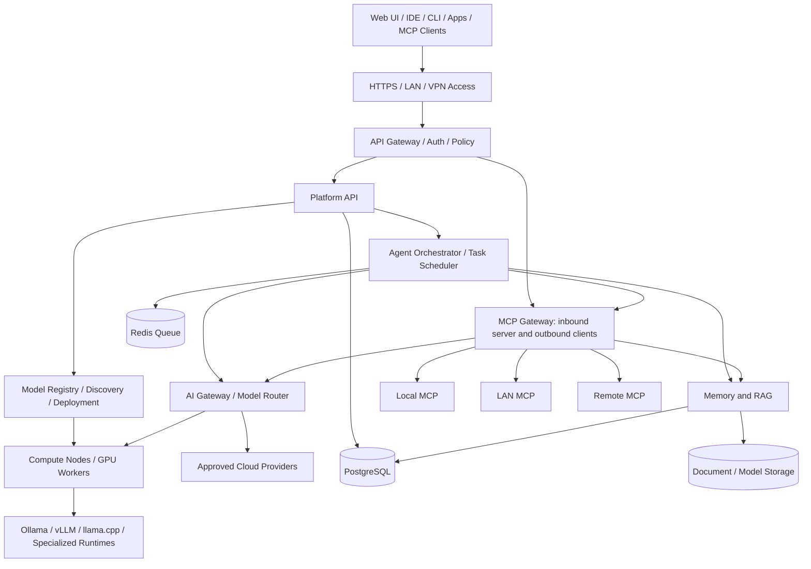

# Nexus AI Platform — Project Handoff

> Connect. Think. Execute.
>
> Your models. Your tools. Your data. Your intelligence.

- Project: Nexus AI Platform
- Repository (proposed): `nexus-ai`
- Python package: `nexus_ai`
- CLI name (proposed): `nexus`
- Database: `nexus_ai`
- Local domain (proposed): `nexus.home.arpa`
- Version target: `0.1.0-alpha`
- Document date: 2026-11-27
- Status: Requirements and architecture proposal; interactive HTML prototype exists; production backend is not implemented.
- Companion files: `nexus-ai-mockup.html` (runnable original UI reference), `NEXUS_AI_MOCKUP_SOURCE.md` (lossless Markdown representation of that source).

เอกสารนี้รวบรวมข้อกำหนดและแนวทางจากการสนทนาเพื่อส่งต่อให้ Codex บน PC ไม่ใช่ข้อยืนยันว่าได้ติดตั้งหรือทดสอบระบบจริงแล้ว ข้อที่ยังไม่ตัดสินใจและข้อเสนอด้านเทคนิคให้พิจารณาเป็น provisional decisions และบันทึก ADR ก่อนเปลี่ยนแปลง

## 1. Project vision

Build a self-hosted, local-first, extensible AI infrastructure platform that unifies local models, optional cloud models, autonomous multi-agent orchestration, bidirectional MCP, persistent memory, RAG, automation and distributed compute. The owner controls models, tools, data and permissions. The platform must run initially on one dedicated server and evolve into multiple GPU nodes without redesigning the application core.

## 2. Confirmed user requirements

| ID | Requirement | User decision |
|---|---|---|
| R01 | Use cases | All types: personal assistant, coding, research, analysis, OCR, multimodal, automation, API integration |
| R02 | Server | New dedicated machine; exact specification not selected |
| R03 | Model strategy | Local first, cloud fallback only when policy allows |
| R04 | MCP | Inbound server + outbound client + central gateway |
| R05 | Network | LAN + Internet access; private VPN preferred as proposed default |
| R06 | Agents | Multiple autonomous agents with task delegation and collaboration |
| R07 | Memory/RAG | Full memory and knowledge system |
| R08 | UI | Custom Web UI |
| R09 | Security | Agent- and tool-level permissions |
| R10 | Scaling | Multiple servers / future AI cluster |
| R11 | Model discovery | Detect models already installed on local and remote engines; register without duplicate download |
| R12 | Model families of interest | Gemma 4, Typhoon, OpenThai, Qwen 4; extensible to other families |
| R13 | Design reference | Existing interactive mockup with shared demo data; preserve and refine the UX |

Model-family names are user preferences, not verified runtime compatibility or availability. In particular do not assume a downloadable open-weight Qwen 4 exists or that all Gemma/Typhoon/OpenThai variants are supported by one engine. Discover exact IDs and capabilities from real engines and verify upstream docs/license before installation. No hardware purchase, model version or cloud provider has been locked.

## 3. Architectural principles

- Local-first, offline-capable core; no automatic disclosure to cloud.
- API-first and MCP-native; distinguish inference APIs, MCP and agent task orchestration.
- Start with modular monolith plus isolated workers and inference services; split only when necessary.
- Separate control plane from execution/data plane. Avoid assuming a worker or model runs on the same host as the UI.
- Default-deny permissions; enforce policies outside the LLM; human approval for high-risk side effects.
- Model/runtime abstraction; no hardcoded list of accepted model names.
- Persist task state and provenance; audit tool calls; use bounded retries, budgets, cancellation and idempotency.

## 4. Target system architecture



Control plane: identity, policy, model registry, agent registry, workflow/task orchestration, scheduling and approvals. Execution/data plane: inference, tool calls, sandbox, document ingestion, embeddings, storage and worker telemetry. Observability, backups and security span both.

## 5. Proposed technology stack

| Component | Initial choice / option |
|---|---|
| Host | Ubuntu 24.04 LTS; NVIDIA drivers + Container Toolkit for GPU nodes |
| Deployment | Docker Compose; K3s/Kubernetes only if later needed |
| Frontend | Next.js, TypeScript, Tailwind CSS, shadcn/ui, Lucide |
| Frontend state | TanStack Query for server state; Zustand if needed for client state |
| Visualization | React Flow for topology/workflows, Recharts or ECharts, TanStack Table |
| Backend | Python + FastAPI, SQLAlchemy, Alembic |
| Persistent DB | PostgreSQL 17 + pgvector |
| Cache/queue | Redis; Celery proposed for background jobs |
| Inference | Ollama first; adapters for LM Studio, vLLM, llama.cpp and specialized runtimes |
| Model gateway | LiteLLM + custom routing and data policies |
| MCP | MCP Python SDK or FastMCP; pin tested protocol versions |
| Agents | LangGraph + custom orchestration policies |
| Security | OIDC/Keycloak later, application policy or OPA, isolated sandbox |
| Storage | Local volumes first; S3-compatible storage as needed |
| Networking | Nginx TLS reverse proxy, Tailscale / private VPN |
| Observability | OpenTelemetry, Prometheus, Grafana; Langfuse optional |
| UI quality | Storybook, Playwright; Thai/English localization planned |

These are recommendations, not installed dependencies. Check current official docs and pin compatible versions at implementation time. Django is an alternative if justified; do not introduce two backend frameworks without need.

## 6. Model Studio and discovery (high priority)

Distinguish model artifact (weights on disk), catalog entry, engine/provider, source/node, deployment (running instance), and capabilities. A model can exist on multiple nodes. Identity should include source and engine-native ID, not only display name. Do not equate installed with loaded or serving.

### Model Sources

Add a new page to the existing UI: register sources using name, engine type, base URL, network zone (Local/LAN/VPN/Remote), credential reference, health status, discovered model count, and last successful sync. Actions: Test connection, Add, Edit, Disable, Sync now, Sync all, View models. Sync must preserve source identity, update stale state and report failures; do not delete registry entries automatically on transient failure. No unrestricted subnet scanning.

| Engine/source | Discovery approach |
|---|---|
| Ollama | `GET /api/tags` installed; `GET /api/ps` loaded; `POST /api/show` details |
| LM Studio | Native models API (`/api/v1/models` if supported by installed version); enable server/auth as required |
| vLLM / llama.cpp | OpenAI-compatible `/v1/models` for served models where supported; separate inventory for unserved artifacts |
| Local GGUF/Safetensors / HF cache | Explicitly configured directories or node agent; import and validate compatibility |
| Specialized OCR/ASR/image runtimes | Custom capability-aware adapter and registered endpoint |

Example diagnostic on PC (PowerShell):

```powershell
ollama list
ollama ps
Invoke-RestMethod http://localhost:11434/api/tags
Invoke-RestMethod http://localhost:11434/api/ps
```

If running Nexus in Docker, localhost refers to the container. Use an appropriate Docker service name or explicitly configured host gateway/LAN endpoint. Never expose unauthenticated Ollama to the public Internet.

### Model lifecycle and use cases

Support catalog/discover, local import, sync, install/download with confirmation, configuration, deployment, start/stop where engine supports it, deletion with confirmation, versioning, model routing, playground, benchmark/arena, and future LoRA/QLoRA training. For engines without start/stop control, show supported operations rather than fake success. Store model provenance, license, parameters, quantization, context, capabilities, disk size and runtime status. Actual VRAM depends on weights, KV cache, context, concurrency and overhead. Do not promise shared VRAM as a single device.

Preferred model families: Gemma 4 for general/vision candidates; Typhoon for Thai, OCR and speech variants; OpenThai for Thai/document candidates; Qwen family for coding/reasoning. Select defaults based on benchmarks, exact model cards and actual availability, not family-name guesses. Other families must be supported too. Model Arena compares same prompt across selected deployments with actual output, TTFT, tokens/s, latency and resource usage; distinguish generated results from synthetic fixtures.

### Execution modes

| Mode | Enforcement |
|---|---|
| Offline | Local/LAN resources as allowed; no Internet/cloud egress; remote access may be unavailable |
| Local | Local model only; external tools only when separate network/data policy permits |
| Hybrid | Local priority; permitted fallback with explicit data policy and budget |
| Cloud | Approved cloud model selection; policy and data restrictions still apply |

A mode label in UI is not enforcement. Enforce at provider gateway, tool gateway and network boundary.

## 7. MCP Gateway

- Inbound: expose approved platform capabilities at `/mcp` using compatible Streamable HTTP and authentication; stdio adapter for same-host clients if needed.
- Outbound: register local stdio processes, LAN HTTP services and remote HTTPS MCP servers. Support transport negotiation, tool discovery, timeouts, cancellation, health checks, reconnect and schema validation.
- Registry: namespaced tool IDs, endpoint metadata, credential references, capability metadata and permission rules; no arbitrary discovered tool automatically enabled.
- Security: deny by default; enforce user/workspace/agent/tool/resource/action scopes, authenticate endpoints, isolate stdio process, validate arguments, audit every call and require approval where relevant.
- MCP tools are not a substitute for inference API or the internal agent task queue.

Proposed tools (illustrative platform interfaces, not shipped APIs): `ai.generate`, `ai.analyze_image`, `knowledge.search`, `memory.recall`, `ocr.extract`, `document.analyze`, `database.query`, `filesystem.read`, `agent.run`, `agent.status`, `workflow.execute`, `system.status`. Validate names and schema against target MCP clients and protocol.

## 8. Agent orchestration

Hierarchical supervisor + graph-based workflows. Start with Supervisor, Developer, Researcher and Reviewer; expand to Personal Assistant, Planner, QA, Data Analyst, Database, Document, OCR, Vision, Automation, Memory and Security agents. Each agent is a configurable role, not necessarily a separate model.

Agent configuration: versioned prompt, primary model, fallback policy, tool allowlist, memory scope, maximum steps, maximum subagents, timeout, token/cost budget, approval rules. Use structured task messages with run/task IDs, parent ID, inputs, outputs and status. Persist checkpoints and support cancellation/resume. Bound delegation depth and revision loops. For code changes use isolated workspace, tests and review; require approval before push/deploy.

Communication: MCP for tool access; internal API for model inference and task delegation; queue for background execution; SSE/WebSocket for UI events; optional A2A adapter in future.

## 9. Memory and RAG

Memory categories: working, short-term conversation, episodic, semantic, procedural, user, project and agent memory. Store scope, provenance, confidence, timestamps, expiration and deletion state. User must be able to view/edit/delete memories and propagate deletion to indexes according to retention policy.

RAG: source registration -> document parse/OCR -> structure-aware chunks -> embedding and keyword index -> ACL-filtered hybrid retrieval -> rerank -> context builder with source citations. Enforce access before content reaches the model. Test Thai segmentation, embeddings, OCR, retrieval and citation quality separately. Support PDF, Word, Excel, source code and authorized NAS folders; document parsers need isolation and resource limits.

## 10. Data model domains (conceptual)

| Domain | Candidate tables |
|---|---|
| Identity/workspace | users, roles, permissions, api_keys, workspaces, projects, memberships |
| Models | providers, model_sources, models, model_artifacts, model_deployments |
| Agents | agents, agent_versions, agent_permissions |
| Chat | conversations, messages, attachments |
| Tasks | tasks, task_runs, task_dependencies |
| MCP | mcp_servers, mcp_tools, mcp_connections |
| Knowledge | documents, document_chunks, document_embeddings |
| Memory | memories, memory_sources, memory_embeddings |
| Workflow | workflows, workflow_runs, workflow_steps |
| Security | policies, approval_requests, audit_logs |
| Cluster | nodes, workers, gpu_devices, worker_heartbeats |
| Monitoring | usage_records, cost_records, execution_traces |

PostgreSQL is the source of truth; Redis is not the sole durable store of task state. Apply workspace scopes, foreign keys, migration tests and deletion/retention policy. This is not final DDL.

## 11. API contracts (proposed)

| Method | Endpoint | Purpose |
|---|---|---|
| POST | /v1/chat/completions | OpenAI-compatible subset |
| GET | /v1/models | Model listing |
| POST | /v1/embeddings | Embeddings |
| GET/POST | /api/v1/model-sources | Manage sources |
| POST | /api/v1/model-sources/{id}/test | Test source |
| POST | /api/v1/model-sources/{id}/sync | Discover models |
| GET/POST | /api/v1/agents | Agent registry |
| POST | /api/v1/agents/{id}/run | Start agent task |
| GET | /api/v1/tasks/{id} | Status |
| GET | /api/v1/tasks/{id}/events | Streaming events |
| POST | /api/v1/tasks/{id}/cancel | Cancel |
| GET/POST | /api/v1/mcp/servers | MCP registry |
| GET | /api/v1/mcp/tools | Scoped tool list |
| POST | /api/v1/knowledge/search | Retrieval |
| POST | /api/v1/documents | Ingestion |
| GET | /api/v1/memory | Memory list |
| POST | /api/v1/approvals/{id} | Approval decision |
| GET | /api/v1/nodes | Compute status |
| MCP transport | /mcp | MCP endpoint |

Define request/response schemas, authentication, errors, pagination and idempotency in OpenAPI before coding. Do not assume every OpenAI API feature is supported.

## 12. Security and network

Permissions are the intersection of caller, workspace, agent, tool and resource policies. Use least privilege. Read-only operations may run automatically when authorized; write within isolated workspace may be permitted; outbound email, Git push, deploy and destructive operations require explicit approval according to policy. Raw secrets and root access denied by default. Bind approvals to exact action/arguments and expiry. Re-check permission on execution. Avoid exposing Docker socket to AI. Treat tool results, files and web text as untrusted data (prompt injection). Use target allowlists, egress controls, SSRF protection including redirects/DNS and controlled private network endpoints. Never trust a client-supplied agent identity. Use secret references, not raw keys in logs/DB/UI.

Nginx HTTPS ingress on 443 for LAN/VPN; frontend 3000, backend 8000, MCP 8001 if split, Ollama 11434, LiteLLM 4000, PostgreSQL 5432, Redis 6379, monitoring internal only. Do not publish internal ports to the Internet. Use Tailscale or private VPN initially. Public endpoint is separate, only when needed, authenticated, TLS protected and rate limited. Back up PostgreSQL and document metadata; test restore.

## 13. UI/UX reference — current mockup and target

Original file: `nexus-ai-mockup.html`. Open in browser without npm or Docker. Source uses vanilla HTML/CSS/JS with mock state `S` seeded from `defaults`, page rendering, modals and localStorage key `nexus-ai-demo-v1`. The original has 22 navigation entries and no real AI or MCP backend. Mockup is UI reference, not production application code. Preserve demo mode while adding separate live mode; never present fake data as live.

### Current navigation and expected interactions

| Group | Page | Mock interaction / target behavior |
|---|---|---|
| Workspace | Overview | System summary, resource and task activity, quick actions |
| Workspace | AI Chat | Model/agent selection, message composer, simulated output and inspector |
| Workspace | Agent Studio | Create/configure agents, tool permissions, run task |
| Workspace | Workflows | Visual workflow, create and simulate run; full drag/drop is future work |
| Workspace | Knowledge Base | Add document, index simulation, search |
| Workspace | Memory Center | Add/edit/remove memory, inspect scope |
| Model Studio | Model Library | Search/import/configure/start/stop; simulated GPU budget |
| Model Studio | Discover Models | Add catalog model to library (no real download) |
| Model Studio | Deployments | Model runtime status and start/stop |
| Model Studio | Playground | Model/prompt/parameters; synthetic response |
| Model Studio | Benchmarks | Synthetic benchmark sample |
| Model Studio | Fine-tuning | Simulate training job |
| Model Studio | Model Router | Change preference by workload |
| Infrastructure | MCP Gateway | Overview, inbound clients, outbound servers, tool registry, logs; add/test/configure connection |
| Infrastructure | AI Providers | Enable/disable example providers |
| Infrastructure | GPU & Cluster | Node registration, simulated GPU/VRAM metrics |
| Infrastructure | Storage | Sample storage and backup capacity |
| Infrastructure | Task Queue | Track, advance or cancel demo jobs |
| Administration | Security | Policy switches and agent permissions |
| Administration | Approvals | Approve/reject sample requests |
| Administration | Monitoring | Synthetic metrics and prototype interaction log |
| Administration | Settings | Theme, data reset and settings |

Target additions not present in original HTML: Model Sources/Discovery Sync, model-family filters for Gemma/Typhoon/OpenThai/Qwen, real Model Arena, deployment capabilities per engine and separate Demo/Live data provider. Add clear error, empty, loading, offline, stale and permission-denied states. Use English UI initially as in prototype; Thai/English localization target.

Design reference from existing HTML: dark default, light toggle, desktop-first sidebar 242px, header 66px, purple accent `#9483ff` / `#7161e5`, background `#0c1018`, sidebar `#10151f`, panel `#141b27`, text `#e7edf7`, muted `#94a2b8`. Original CSS is authoritative for matching mockup; earlier conceptual palette may differ. Use responsive navigation, accessible focus, keyboard search Ctrl+K, toasts, confirmation dialogs, shared mock/live state abstraction. Do not redesign silently.

## 14. Project structure (proposed)

```text
nexus-ai/
├── AGENTS.md
├── README.md
├── apps/
│   ├── web/                  # Next.js
│   └── api/                  # FastAPI entrypoint
├── services/
│   ├── ai_gateway/
│   ├── model_management/     # sources, registry, deployment, adapters
│   ├── mcp_gateway/
│   ├── orchestrator/
│   ├── memory/
│   ├── knowledge/
│   ├── security/
│   └── cluster/
├── workers/                 # agent, inference, document, sandbox
├── packages/                # contracts, sdk, database, common
├── integrations/            # MCP, cloud, custom tools
├── infrastructure/          # Docker, proxy, monitoring, backup
├── configs/                 # agents, models, policies
├── tests/                   # unit, integration, contract, security, eval, e2e
├── docs/
│   ├── 01-project-overview.md
│   ├── 02-software-requirements.md
│   ├── 03-system-architecture.md
│   ├── 04-technical-design.md
│   ├── 05-database-design.md
│   ├── 06-api-specification.md
│   ├── 07-mcp-gateway-design.md
│   ├── 08-multi-agent-design.md
│   ├── 09-security-architecture.md
│   ├── 10-development-roadmap.md
│   ├── adr/
│   └── references/
├── compose.yaml
├── compose.dev.yaml
├── .env.example
└── Makefile
```

Keep services as modules initially where appropriate. Compose should have private frontend/backend networks and explicitly controlled outbound connectivity; database/cache volumes; health checks; pinned image versions; least-privilege containers; no real secrets committed. Model downloading/provisioning needs controlled outbound access. Provide dev and production profiles. Do not claim working Docker deployment until tested.

## 15. Hardware and cluster (planning only)

Target new GPU-capable Ubuntu host; exact CPU/GPU/PSU/board/budget not decided. Previous rough target: CPU 12–16 cores, RAM 64–128 GB, model SSD 2 TB, GPU 24–32 GB VRAM as possible starting point, dual-GPU expansion and appropriate PCIe lanes/cooling/PSU; heavier workloads may require more. Existing RTX 3060 Ti host could serve OCR/embedding if owner chooses. No hardware benchmark is available.

Cluster scale order: distribute independent tasks first, then replicate models, then evaluate tensor/pipeline parallel inference across GPUs/nodes when necessary. Node agent reports device identity, VRAM/RAM, health and engine capabilities. Scheduler uses actual available resources and limits concurrency; isolate training from inference. Worker enrollment authenticated; handle lost heartbeat and stale jobs. No multi-node inference guarantee without benchmarking interconnect and engine compatibility.

## 16. Development roadmap and gates

| Phase | Scope | Definition of done |
|---|---|---|
| 0 | Requirements, architecture, ADR, threat model, scaffold, environment | Development stack boots, contracts documented, basic checks pass |
| 1A | Demo UI + read-only live Ollama discovery | Real installed/loaded lists from configured source, no duplicate download, clear error/stale states; demo still works |
| 1B | Core AI chat + bidirectional MCP MVP | Local streaming chat, auth, scoped tools, LAN/VPN access, policy-controlled cloud fallback, audit |
| 2 | Multi-agent | Supervisor delegates bounded tasks to specialist agents; checkpoint, cancel, resume and approvals |
| 3 | Memory/RAG | Thai/document retrieval with citations, workspace isolation, deletion propagation |
| 4 | Production hardening | Strong identity, sandbox, secrets, monitoring, backup/restore, security tests |
| 5 | Automation, benchmark, training | Scheduled workflows and capability-specific evaluations; supported training/deploy flow |
| 6 | Distributed cluster | Authenticated new worker registration, remote task routing, resource scheduling |

Phase 1A is an added incremental milestone proposed in this handoff to reflect the latest request about discovering installed models. Security baseline must exist before real tool/network use; Phase 4 is hardening, not first introduction of security. Timeline not committed.

## 17. Acceptance tests

- Demo mode never calls actual model/MCP endpoints and is clearly labeled.
- Live mode discovers configured Ollama models and loaded state; stopped/unreachable source is reported accurately; no fabricated data.
- Local model chat works with Internet disconnected if model and local dependencies are provisioned.
- Local-only data never leaves through cloud fallback or remote tools without permission.
- Unauthorized agent/tool/resource call is rejected; arbitrary destination or injected instruction cannot bypass policy.
- MCP timeout and disconnect produce clear errors; protocol negotiation validated with real compatible clients.
- Approval is bound to exact action; retry of side-effecting action cannot silently duplicate it.
- Agent step/delegation/time limits, cancellation and checkpoint recovery tested.
- GPU allocation accounts for overhead; insufficient capacity queues or fails safely.
- RAG ACL isolation and memory deletion propagation tested.
- New worker can be registered without changing agent business logic; offline worker is not scheduled.
- Backup restored and validated; secrets never logged; security controls covered by tests.
- UI e2e tests exercise all implemented menus and flows, responsive states, and demo/live separation.

## 18. Codex kickoff prompt

Copy this prompt into Codex in the target repository after placing this file and the HTML reference there:

```text
Read NEXUS_AI_PROJECT.md and inspect nexus-ai-mockup.html first. This is the requirements and design handoff for Nexus AI Platform. Do not assume the mockup is connected to any real service.

1. Inspect the current repository and environment without modifying them. Identify existing code and installed runtimes.
2. Summarize the confirmed requirements, provisional architecture decisions, gaps and risks. Create an incremental implementation plan and ADR list.
3. Propose AGENTS.md and the docs/ structure, with clear development conventions, security requirements and test commands. Keep all source changes compatible with existing project state.
4. Start with Phase 0 and Phase 1A only: scaffold the Next.js/FastAPI application with a preserved demo UI and separate read-only live Ollama source discovery. Do not implement the entire cluster or training system in one step.
5. Build source test/sync and installed vs loaded model views. Use real engine-reported IDs and capability-aware adapters, not hardcoded model families. Include mock fixtures for Gemma 4, Typhoon, OpenThai and Qwen as clearly labeled examples; verify real availability independently.
6. Enforce secure configured endpoints, credentials, least privilege, and error/stale states. Do not download/delete real models, expose ports publicly, run arbitrary tools, send data to Cloud, or alter host configuration without my explicit approval.
7. Add unit, integration (mock engine) and UI tests. Report actual test results, commands, files changed, assumptions and unresolved issues. Never represent mock behavior as live functionality.

Preserve the design language of the HTML reference. Propose changes before replacing architecture or UI conventions. Use current official documentation and pin versions after checking compatibility.
```

## 19. Open questions / limitations

- Exact PC/server OS and GPU specifications at development time; first server budget, models and concurrent user/request target.
- Whether public external clients without VPN are required; final domain and identity provider.
- Cloud budget, allowed providers and data categories; retention/backup targets.
- Final model licenses, actual availability and runtime compatibility; verify before implementation.
- Project name and CLI/domain availability not verified for trademark or naming conflicts.
- Original HTML has synthetic model names, VRAM, benchmark metrics, MCP endpoints, task state and approval effects. It is not production code. The new discovery UI and model-family additions were discussed but not merged into the original file.
- This document consolidates conversation decisions; it does not certify dependency versions, performance, or operational readiness. Review ADRs and acceptance tests as implementation proceeds.
